# DunesForge - scene gallery

*Back to [README](README.md) - [QuickStart](docs/DunesForge_QuickStart.pdf) - [Reference](docs/DunesForge_Reference.pdf)*

Every image below is a **demo scene that ships with the add-on**, rendered from the build as it stands. Open any of them from **Presets > Demo Scenes**, press Play, and take the settings apart.

The captions are the scene descriptions from the add-on itself, so what you read here is what you see in the panel.

---

## In motion

Each frame is the solver advancing - nothing here is keyframed.

---

## Grand Scenes - several systems in one 400 m landscape

### Grand Scene: Winter Storm

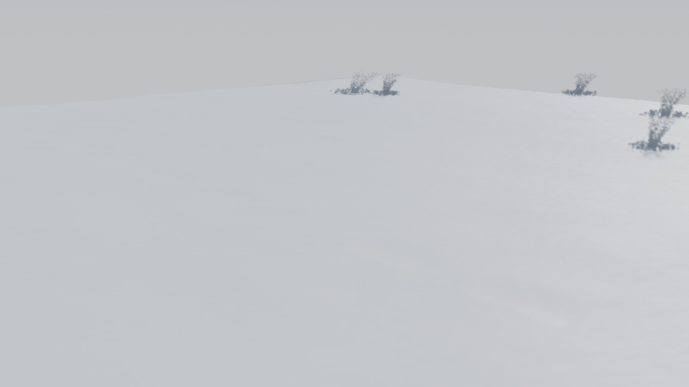

A 400 m snowfield with layered drifts, density, slabs, shelter and snow-fed vortices

### Grand Scene: Dynamic Coast (Experimental)

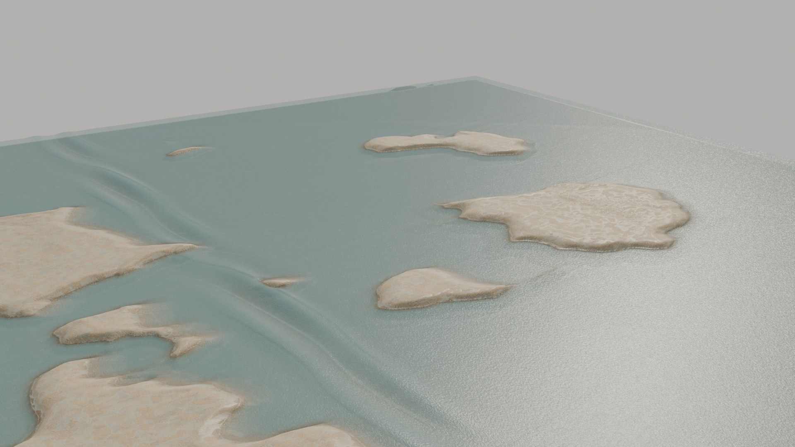

A 400 m coast with Flow 2D wind, shallow water, waves, sediment, rain and vegetation

### Grand Scene: Desert Expedition

A 400 m landscape with dunes, grains, rock shelters, sources, tracks and airborne dust

### Grand Scene: Living Oasis

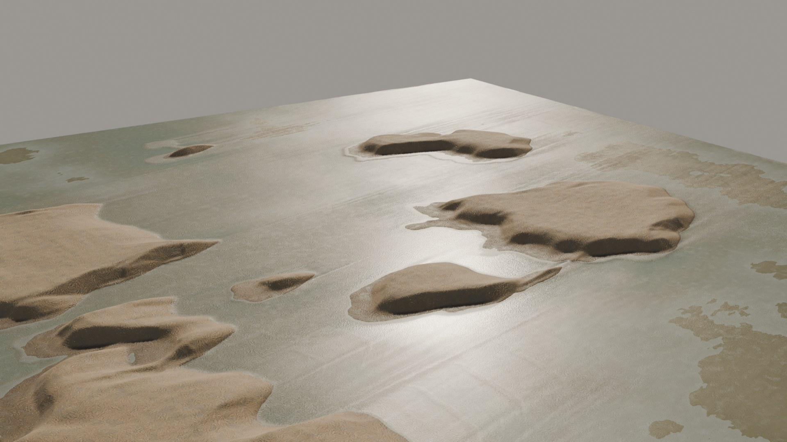

A 400 m rain-fed basin combining wet shores, plant species, growth and surface weathering

---

## Showcase scenes - related features side by side

### Showcase: Airborne + Dressing

Everything that is not the heightfield: swept sand-haze particles emitted off exposed crests and settling in the lee, wandering dust devils, a curve imprinted as a rut with berms, and pebble scatter driven by the simulation masks

### Showcase: Surface Detail

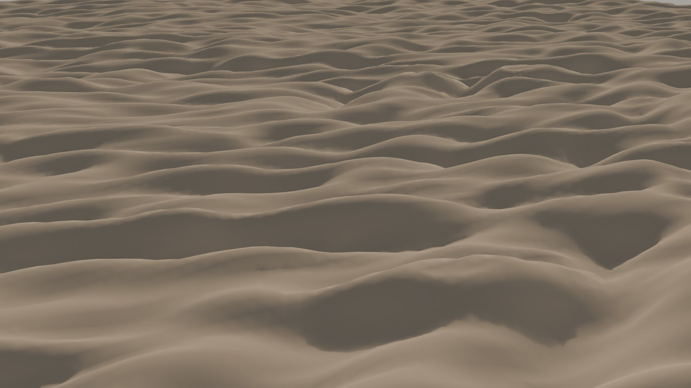

The layer that lives ABOVE the dune, shot from close enough to see it -- from the usual demo distance it is smaller than a pixel. The Micro-Detail pass has been run once already, freezing the dunes as bedrock and running transport again at a finer scale over them, with Crispness, Crests and Slump Allowance set; those three do nothing until the pass is RUN, so press the button again after changing them. De-facet Crests takes out the straight grid zigzag that a one-direction wind leaves along the crest lines, Edge Rounding takes the corner off the brink but not off the flats, and Detail Feeds Sim hands a little of the detail back to the solver so the ripples are sand rather than a decal the wind ignores

### Showcase: Grain Systems

The grain-scale models together: Multi-Fraction winnowing fines out into an armouring coarse-lag pavement, Strata painting cross-bedding on cut faces, Sand Age reading fresh on scoured slip faces, and the physical ripple solver at megaripple scale. Ships with the Surface Shader so all of it is visible

### Showcase: What Objects Tell The Sand

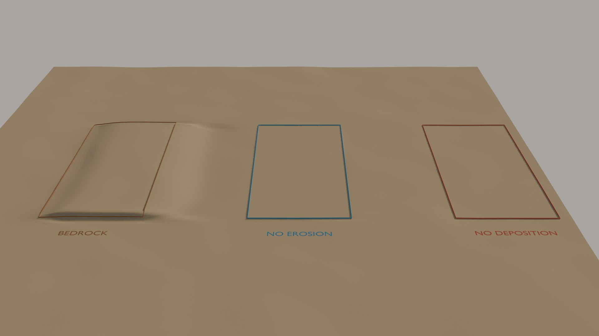

Three slabs on one moving sand sheet, each holding the ground to a different rule, with every number below measured on the scene itself. BEDROCK is a floor the sand cannot sink below; this one sits above the sheet, so it stands as a rock sill the sand flows around, 1.43 m proud of the field. ERODE is the quiet one: the ground there stops moving altogether, roughness 0.0025 against 0.30 for the sheet beside it, so dunes travel past a patch that never changes. NO-DEPOSIT is the one people mix up with it: nothing new lands, while whatever sand is there is carried off as usual, so the footprint SINKS -- 0.12 m after the warm-up and 0.38 m after 300 steps more. Erode holding still while No-Deposit digs itself out is the whole point

### Showcase: Object Masks

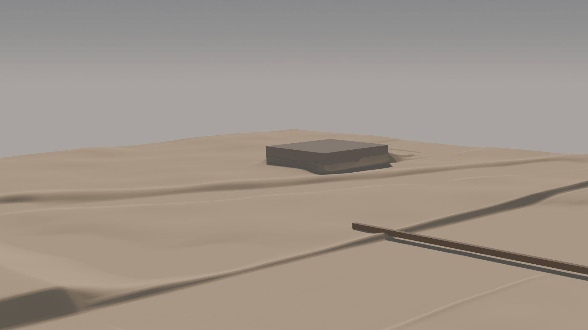

Three object slots doing three different jobs in one scene: a source box feeding fresh sand, a wind-gain box acting as a gust lane, and rock obstacles casting wind shadows. Every one of these masks can also be painted with the Interactive Brush

### Showcase: Surface Shader

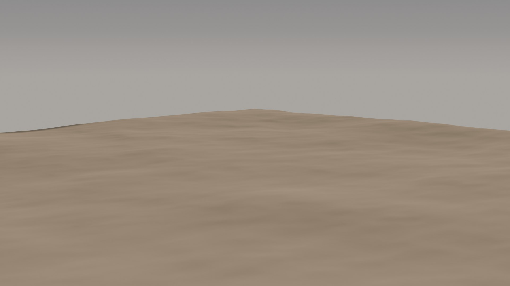

How the surface texture is PROJECTED, rather than what it is. A flat top-down projection stretches the grain down every slope and a dune is mostly slope, so this scene switches the scanned sand and the bedrock onto a triplanar projection and turns up the four map-side controls: the scan follows the wind heading and the local downslope, the procedural/scan balance becomes a map instead of one number, and the terrain sits in its own ambient shade. Note the trade it has to make: triplanar and Hex-Tiling cannot both run on the sand, so the scene uses Texture Bombing -- put Hex back and the triplanar tick silently stops doing anything

---

## Terrain - starting from a landscape type

### Terrain: Islands + Water

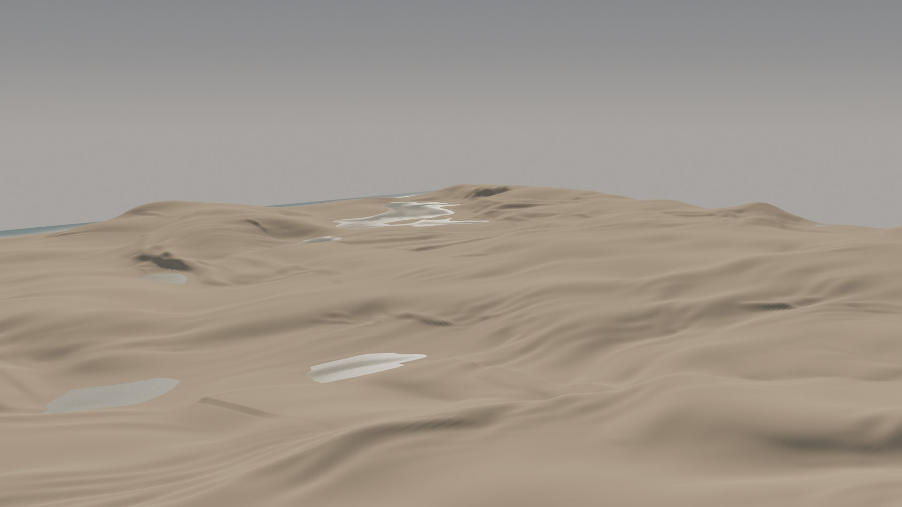

Scattered high ground in a shallow sea: wet locked shores, dry migrating crests, and rain to tie the two together

### Terrain: Beach + Buildings

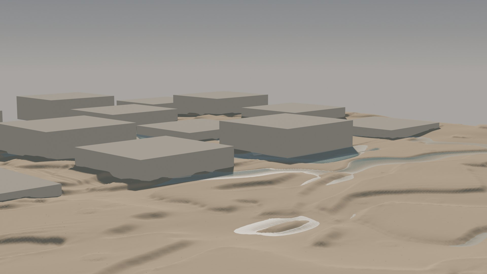

A shallow shore with a water table, a row of buildings behind the dune line, and sand drifting up against them

### Terrain: Canyon

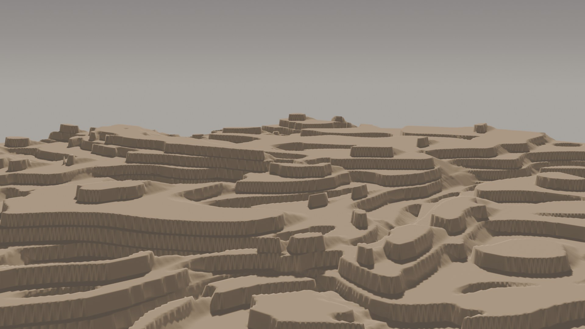

A terraced, deeply-cut canyon frozen as bedrock with sand fed along the floor, so drifts snake between the walls and pile against them

### Terrain: Crater Basin

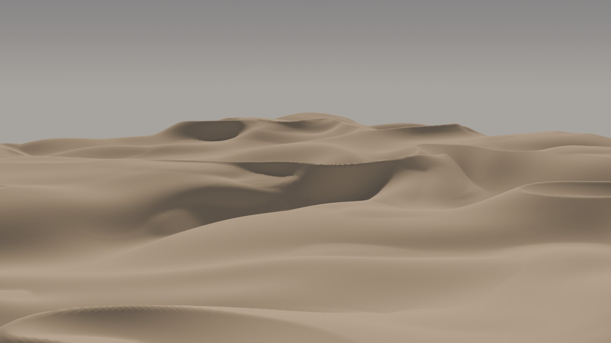

A steep-walled basin that traps everything blown into it -- a sand trap, and a good stress test for avalanching on rock

### Terrain: Ready Dune Field

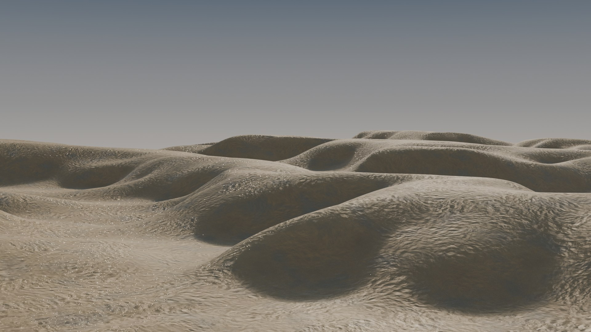

Wind-aligned ridges as the starting field, so a mature dune sea exists from frame 0 instead of forming over hundreds of steps

### Terrain: Cellular Mesas

Turbulence terracing gives flat-topped mesas with steep sides; sand streams around them and builds lee tails behind each

### Terrain: Mountain Range

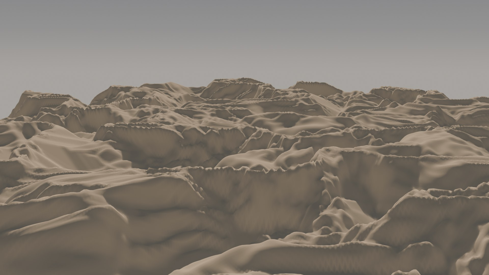

Ridged fractal peaks with sand collecting in the valleys -- the classic case where the rock is the scenery and the dunes are what moves through it

### Terrain: Stepped Plateau

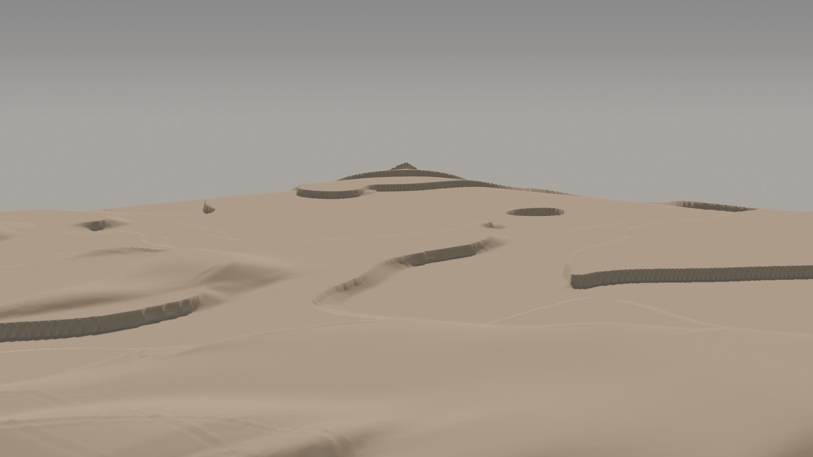

Hard terraces frozen as bedrock, with sand only on the steps -- shows the non-erodible rock path and how sand cascades between levels

### Terrain: Rolling Hills

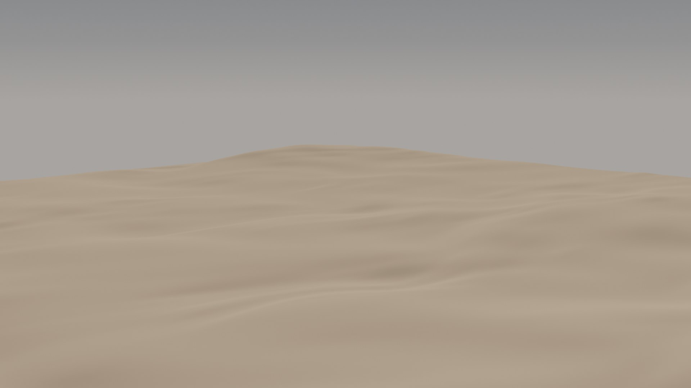

Soft FBM hills with a full sand cover: gentle relief where the dunes and the ground shape each other

### Terrain: Buried Town

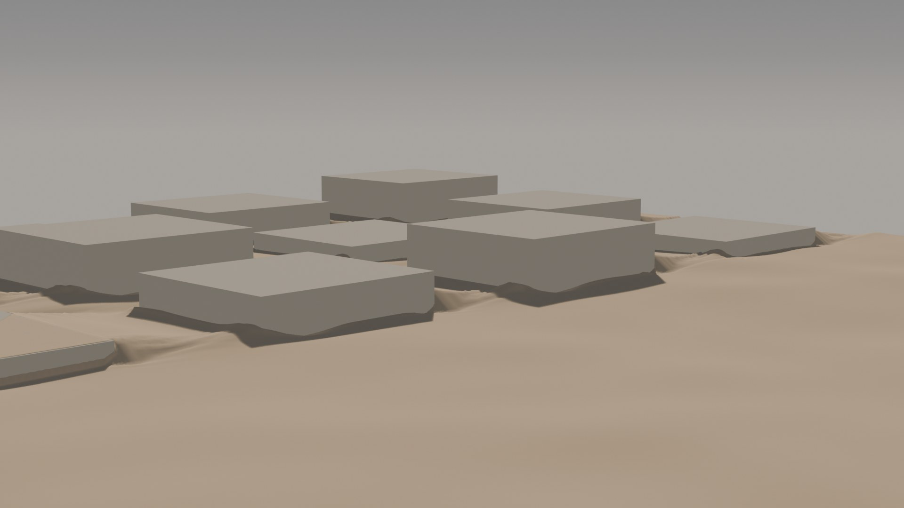

A block of buildings on an open plain being swallowed by sand: each one casts a wind shadow and grows its own lee drift

---

## Water, rain and ice

### Ice: Pack, Ridges and Leads (Experimental)

The ice mechanics of 1.3.134-1.3.138 in one scene: a frozen basin kept ALIVE by a steady inflow, so the pack never settles. The current carries the sheet, piles it against the shore into RIDGES where it converges and pulls it open into LEADS where it diverges -- all three out of one conservative flux, with no extra rule. MEASURED, and this is why the demo exists: on the Pools That Flow terrain the water reaches equilibrium and the ice sampled a LIVE current in only 2 of 20 steps, so none of it could be seen. With the inflow on it is 20 of 20. Try Ice Yield Strength 20 -> 0 and watch the ridge turn into an even thickening

### Rain: Wet Sand + Plants

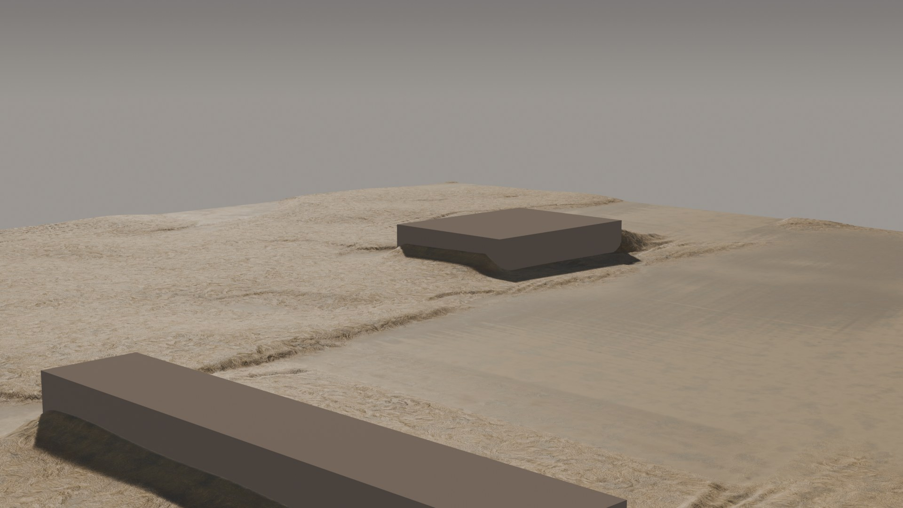

Storm cells sweep a formed dune field: the dunes are built DRY first, then the rain arrives, so you can see what it changes. Damp patches go dark and matte and stop moving, the lee of the rocks stays dry in the rain shadow, and vegetation greens up where the root zone holds water and then pins the sand down

### Rain: After The Storm

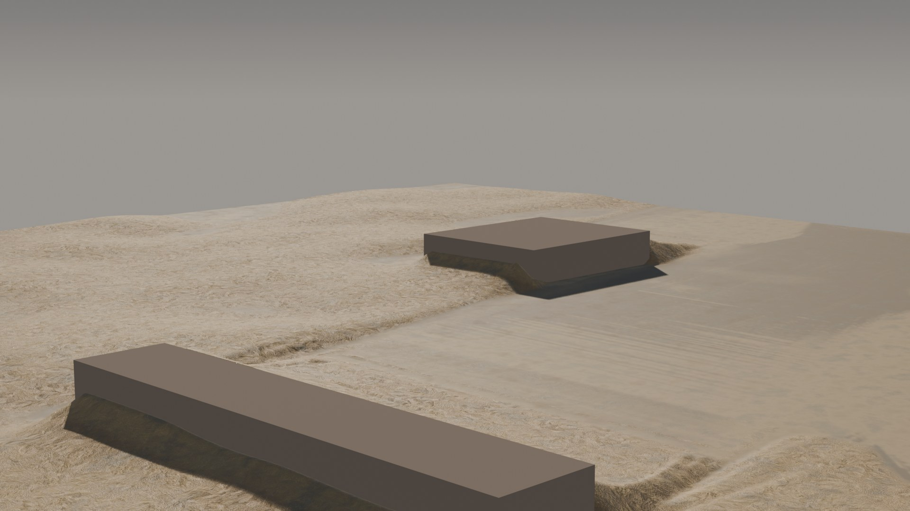

The field is soaked and then the rain STOPS. Wind Drying makes exposed crests dry first while sheltered lee slopes stay damp, so the dunes wake up unevenly instead of all at once -- the clearest demonstration of the wind/moisture coupling

### Rain: Monsoon Shutdown

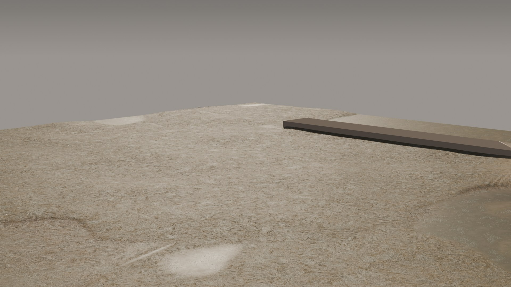

The heavy end of the rain model: near-total coverage, slow cells and strong infiltration, so almost the whole field goes wet and almost all of it stops moving. Shows what OUTLIVES the rain -- a drying crust plus the vegetation it fed, which keep holding the sand after the weather has gone

### Rain: Wet Oasis

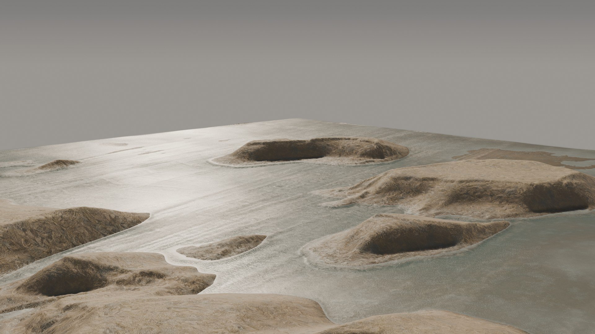

Water table AND rain at the same time: two independent sources feeding one wetness mask, each with its own hold strength. Plants ring the standing water where the root zone never dries out. Good for checking that the two systems combine rather than fight

### Oasis: Water + Valley Masks

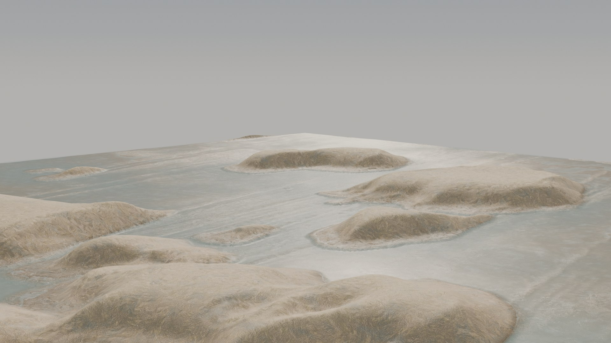

Sand placed in valleys around a shallow water table with a translucent water plane: wet shores lock in place while dry sand keeps migrating around them

### Water: Pools That Flow (Experimental)

The SAME oasis as above, with the water given a depth field instead of one global level -- so every hollow settles to its own height, water runs downhill between them and the shore is wherever the ground says. Built as a direct A/B against the Oasis demo: same terrain, same warmup, one switch different

### Water: Reservoir Behind A Sluice Gate (Experimental)

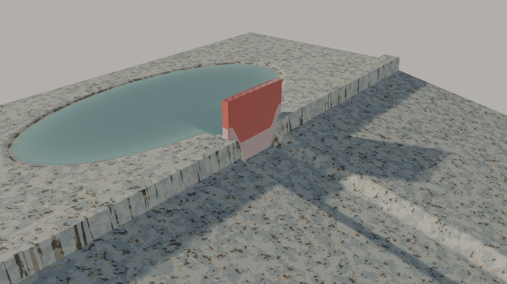

A rock plateau with a 6 m basin, a dam with a 16 m gap and a valley below. The basin holds 1.5 m of water above the sill; a red gate in the gap is an ordinary obstacle that, with Water Sees the Rocks on, is part of the water bed and holds the water back. It is KEYFRAMED to lift 24 m from frame 20: press Play and the reservoir pours down the valley as a shallow-water flood. MEASURED on a fixture of this geometry: without the gate 7.8 % of the water is below the dam after 20 s and 34.8 % after 120 s, with the gate 0.0 % for 120 s, gate removed at 40 s -> the same curve shifted by 40 s; mass 1.0000. Try Water Sees the Rocks off: the flood starts at once

### Water: Wind On The Lake (Experimental)

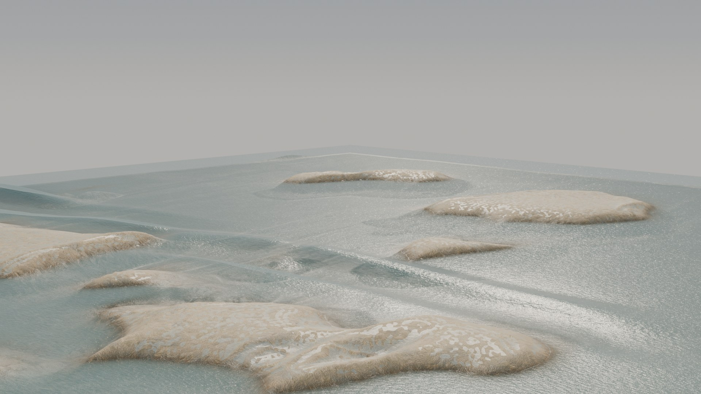

The flowing field with a 30 m/s wind gripping the surface. The water piles up on the DOWNWIND shore at a slope of exactly tau/(rho g h), so the shoreline moves and the pools lean. MEASURED on this terrain at 30 m/s against no wind, after 3 s of water time: 7699 cells cross between wet and dry -- 4010 flooded and 3689 drained -- and the surface stands 13.7 mm apart at most. The wind here is the ANALYTIC one, so it is the same everywhere; switch Wind Model to Flow 2D and give the flow an Air Layer to have crests and lee pockets push the water differently

---

## Snow, frost and avalanches

### Snow: Slab Avalanche

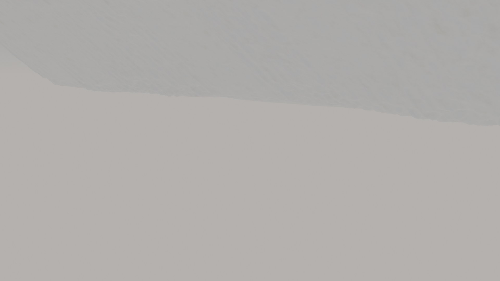

A weak layer buried under a wind slab lets go on a 38 degree face and the debris RUNS OUT onto the flat below. This is the one scene where Slab Dynamics is on: without it the released mass is only ROUTED downhill, which moves it DOWN THE SLOPE rather than out across the flat. MEASURED on this scene, the two models differ by 10.7 % of the released mass: turning Dynamics on shifts 266 units off the upper face and lays them on the runout, concentrated around 75-87 % of the way across. Both models DO reach the valley floor and both stop at the same 95th-percentile distance -- the difference is WHERE the debris piles up, not how far it gets, and in a wide shot it is only 0.12 % of pixels. Look at the runout zone, not at the whole slope. MEASURED, and it is why the scene sculpts its own mountainside rather than using noise: on the stock demo terrain the 95th-percentile slope is 0.103 against a release threshold of tan(34) = 0.675 -- six times too flat, and 220 steps released nothing at all. Try Slab Dynamics 1 -> 0 and watch the pile move UP the runout toward the foot of the face

### Frost: Hoar on Snow

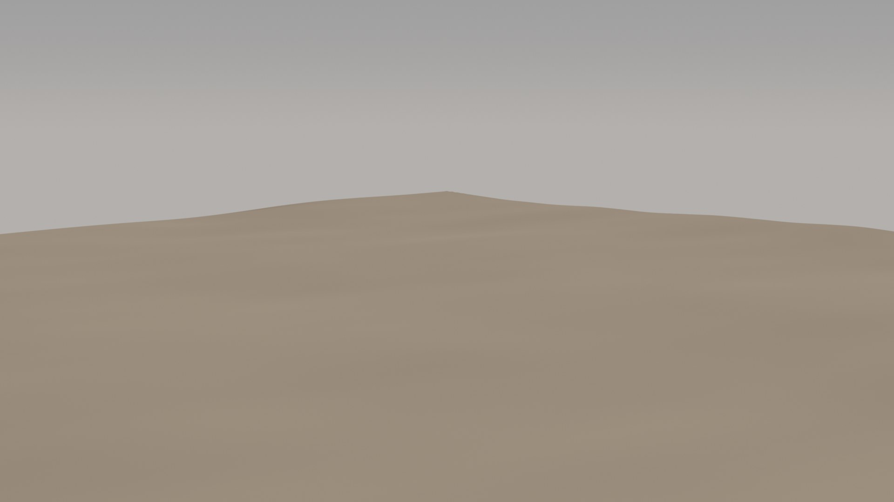

A cold, sheltered snowfield growing surface hoar -- the weak layer a later slab will release over

### Sand: Slide Under Gravity

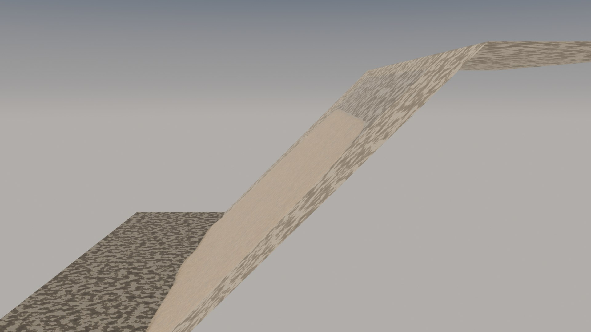

No wind. A rock face sculpted to 45 degrees, steeper than the Repose Angle (34), with a 0.6 m strip of sand and two thicker patches painted on it. The repose relaxation runs every step whether or not the wind blows, so the sand slides on its own and stops where its surface reaches 34 degrees. MEASURED on this scene (512 cells): 91 % on the face when the demo opens, 73 % after 20 steps and at rest from 40 steps on at 69.5 %, with 30.5 % at the foot as talus, mass kept to the last digit; with Avalanche Passes 0 nothing moves at all. Try Repose Angle 34 -> 25 (rest at 49 %) or 40 (85 % and still creeping)

### Snow: Sluffs Off A Rock Face

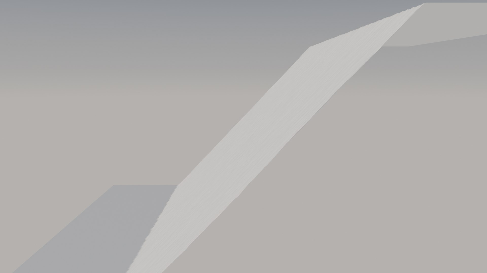

The same rock face at 50 degrees, no wind, and a storm falling straight down. Snow landing above the repose limit sluffs to the foot as it falls; with Avalanche Trigger 6 it holds a few degrees past repose and lets go in events. MEASURED: 30-40 % of what fell on the face is still there when the storm ends, the drops come in steps of up to 0.18 points per step against 0.04 with continuous relaxation. Snow Repose Offset does NOT change this -- it belongs to the slab model (measured 0 / +12 / +20 identical). Try Avalanche Trigger 6 -> 0

### Snow: Drifts + Fence

Wind-packed snow drifting behind a slatted fence, with a snow material and cool daylight. Shows the snow solver and obstacle wind shadows building lee tails

### Snow: Fresh, Packed and Drifted

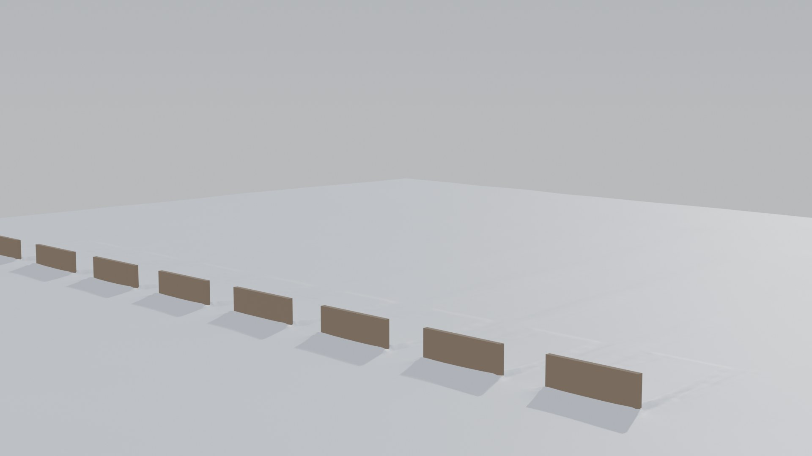

The same fence and the same wind as Snow: Drifts + Fence, with Snow Density switched ON -- so the pack stops being a depth and starts being a MASS. A depth-only solver cannot tell 10 cm of powder from 10 cm of settled snow; MEASURED on the gate fixture those are 10.00 and 50.00 kg/m2, five times apart at the same depth, and across this field the mass runs 0.37 to 17.42 kg/m2. Drifted snow is denser than the snow that fell, because the grains shatter in saltation and pack tighter, so the drift behind the fence settles SHALLOWER and HARDER than the fresh fall around it -- measured mean hardness 0.1204 at Drifted Density 350 against 0.8125 at 100. Try Drifted Snow Density 350 -> 100: the mechanism switches itself off bit for bit and the pack deepens again

### Snow: A Thaw That Leaves One Patch

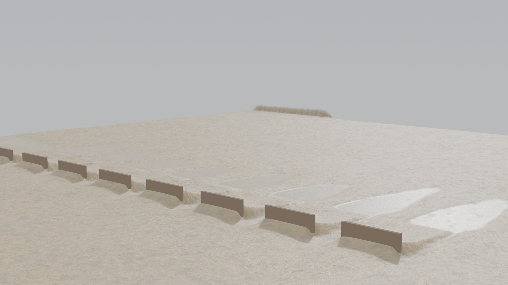

The drift field and the same fence, run through a THAW. Snow lies at Initialize (Initial Snow Depth 0.5), the winter builds the drifts, and then the air goes to +8 C with Melt Rate on -- and the field loses ALL of it. MEASURED over 30 steps: mass of the fresh layer 20 584 with no thaw against 0 with it, cover 98.2 % against 0.0 %. One patch survives, because a snow EMITTER keeps feeding it: Snow Source Rate 0.05 over a box, feathered by Snow Source Smoothing, holds 2 842 of mass and 4.9 % cover when everything around it is bare. MEASURED and the reason this scene keeps the TyDunes surface shader instead of the flat snow material the other snow demos wear: on flat white paint the same thaw changed frame brightness from 0.7232 to 0.7200 and the renders looked identically white -- only the drift relief moved. With the snow mask driving the surface, the thaw repaints 57.1 % of the pixels and the emitter patch another 4.4 %. Try Melt Rate 0.01 -> 0 with the air still warm: melting is Melt Rate PLUS the temperature term, so the warm air alone still takes it, just more slowly. Try Snow Source Rate 0.05 -> 0: the last white patch goes with it

### Temperature: Spring Thaw

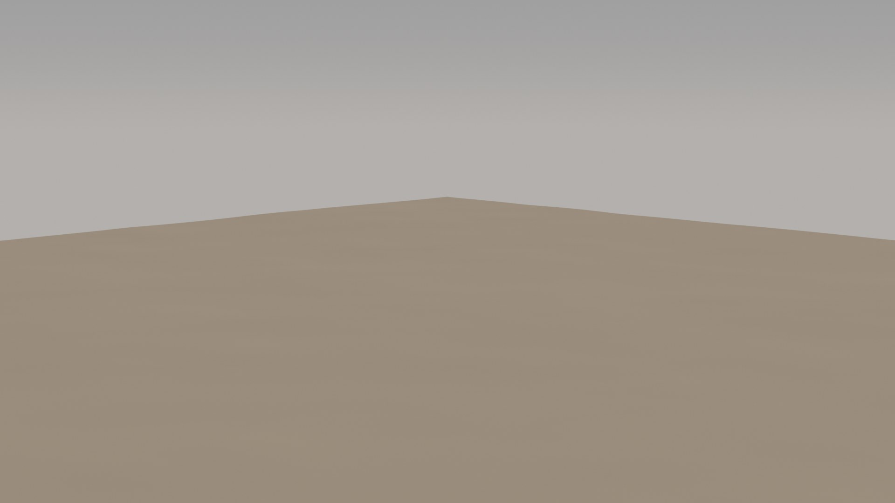

A snowfield under a rising sun -- melt on degree-days, so it stays put until the air crosses zero and then goes quickly

---

## Vegetation

### Vegetation: Blowout Hollows

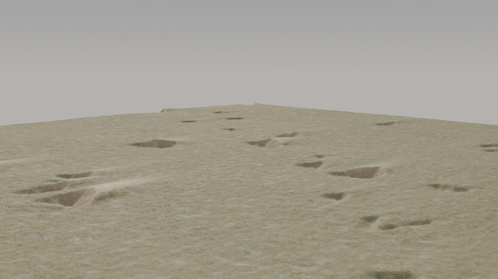

The opposite starting point: a fully vegetated coastal grassland with bare gaps punched in it. The wind scours the unprotected gaps into deflation hollows while the anchored surroundings hold, which is how a blowout -- and eventually a parabolic dune -- gets going

### Vegetation: Nabkha Hummocks

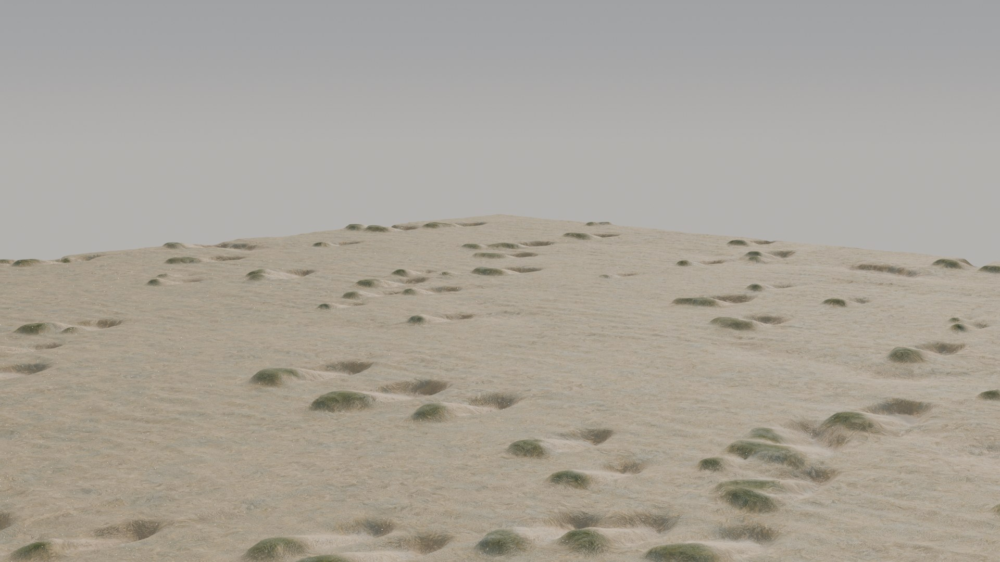

Scattered plant clumps on a sand-fed plain, each one trapping a mound with a downwind tail -- the nabkha (coppice dune) landform. Built with the patch-shape controls open, so the clumps are ragged, come in a range of sizes and grow in stands instead of being identical circles on a uniform scatter, and with the clumps taking their own darker colour so a hummock reads as a bush and not as a green stain

### Plants: Two Species Side By Side

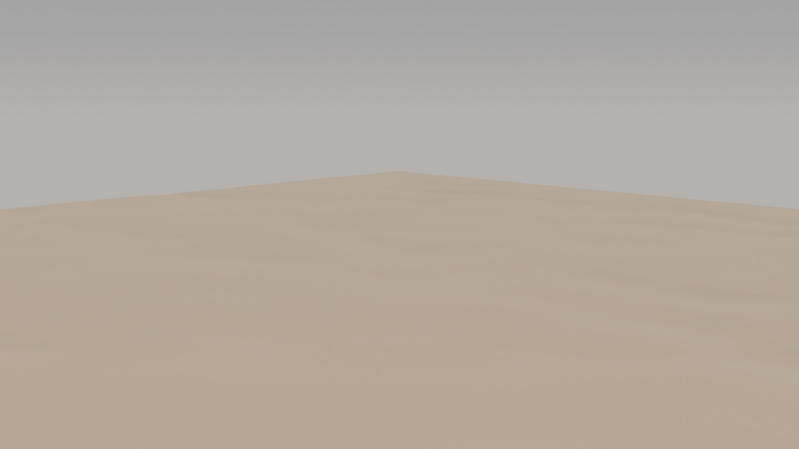

A succulent and a grass on the same dune, which is the commonest arrangement on a real one. Drought Tolerance used to be ONE number for the whole scene, so the two could not stand together; above 0 Second Species turns it into a FIELD of patches, deterministic in Seed. MEASURED on the gate fixture, cover of the tolerant plant against the sensitive one: 0.4973 / 0.7078 with one species (a +0.2105 gap that is just the two thresholds) against 0.5087 / 0.7811 with the species map on -- the gap widens to +0.2725 because each plant now sits where it can. The two colours are what makes it readable: Vegetation Colour is the grass, Vegetation Colour B the succulent. Try setting Tolerance (Species B) equal to Drought Tolerance: the map stops mattering and the result goes back to being identical to the bit

---

## Flow 2D - wind that goes around things

### Flow 2D: Canyon Jet

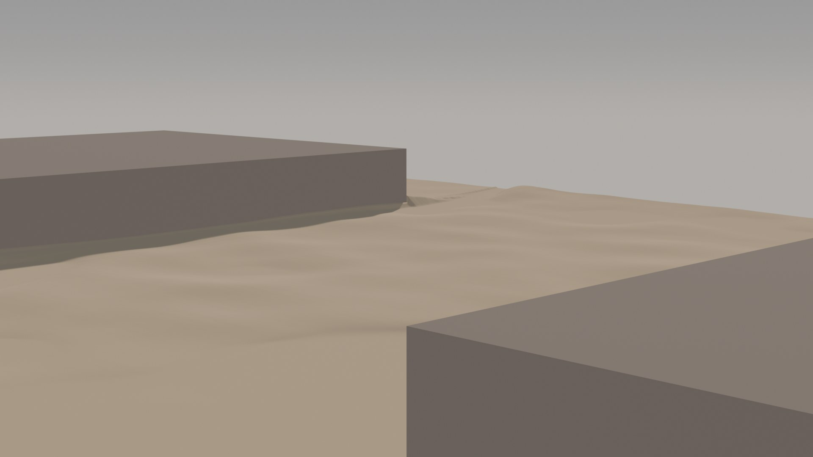

Two rock walls with a gap. The solved wind speeds up through the gap because the same air has to pass a narrower opening -- a result of mass conservation, not of a correction term

### Water: Ripples Carried By The Current (Experimental)

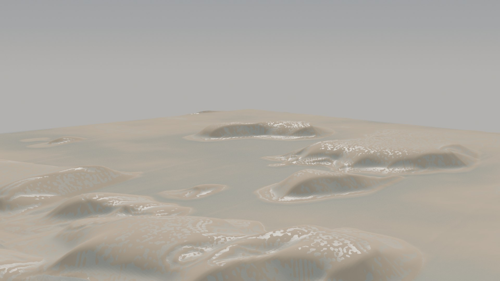

The Pools That Flow basin with a DEAD SWELL pumping it, so the current never settles -- and that is the whole condition of this scene. Flow Ripples makes the fine chop read the FLOW FIELD instead of an independent noise: the pattern stretches along the current and twists where it turns. MEASURED on this scene: straight after the warm-up the basin is in EQUILIBRIUM -- peak speed 0.0 and 0.0 % of cells moving -- so the knob changes 0.000 % of the pixels, because there is no flow to read. With the swell on: peak 36.15, mean 0.218, 70.4 % of cells alive, and the same knob changes 4.69 % of the pixels on the built scene (4.84 % on the gate fixture) against 0.000 % render noise. Try Flow Ripples 2.5 -> 0: the chop goes back to an independent noise that does not know where the water is going. Try Swell Height 0: the basin settles, the current dies, and the knob stops mattering -- which is the same trap the Ice: Pack scene documents

### Flow 2D: Recirculating Wake

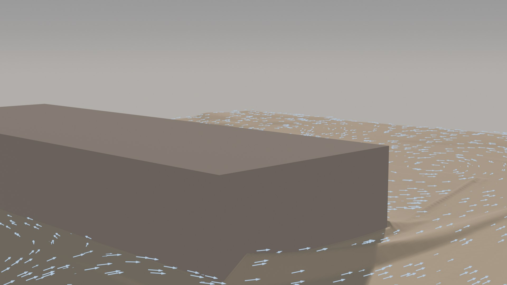

A single bluff rock. Behind it the flow REVERSES and turns back on itself, which the analytic wind cannot do at all -- it has a lee shadow but no momentum

---

## Phenomena

### Desert: Dunes + Obstacles

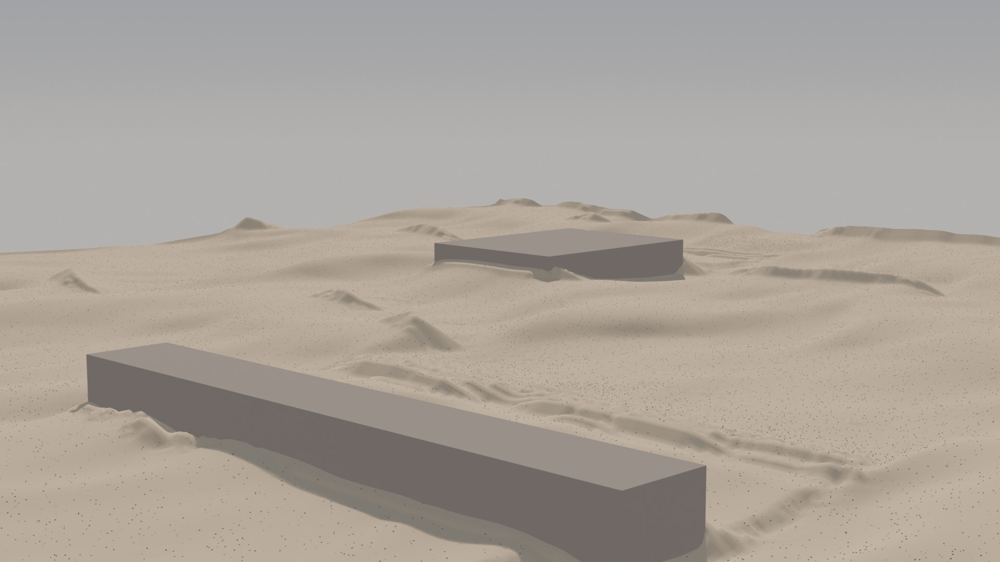

Classic sand dune field with rock obstacles casting wind shadows, pebble scatter, camera, sun and a sand material. Pre-runs the simulation so dunes are already formed

### Phenomena: Snow Fence

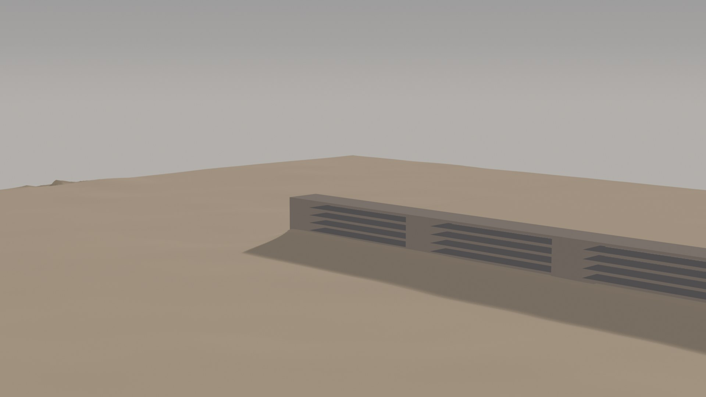

A POROUS blocker: the long downwind drift a real snow fence builds, next to the short steep pile a solid wall makes

### Phenomena: Playa Crust

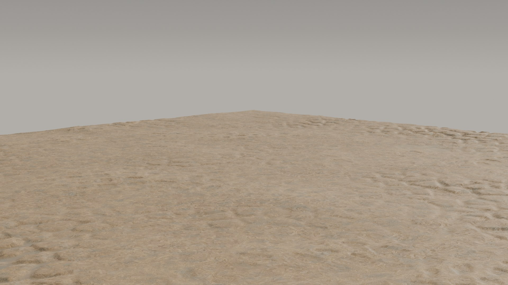

A dried lake bed: the crust sets and cracks into plates, and the wind deflates along the cracks while the plates stand

### Phenomena: Wind Erases Tracks

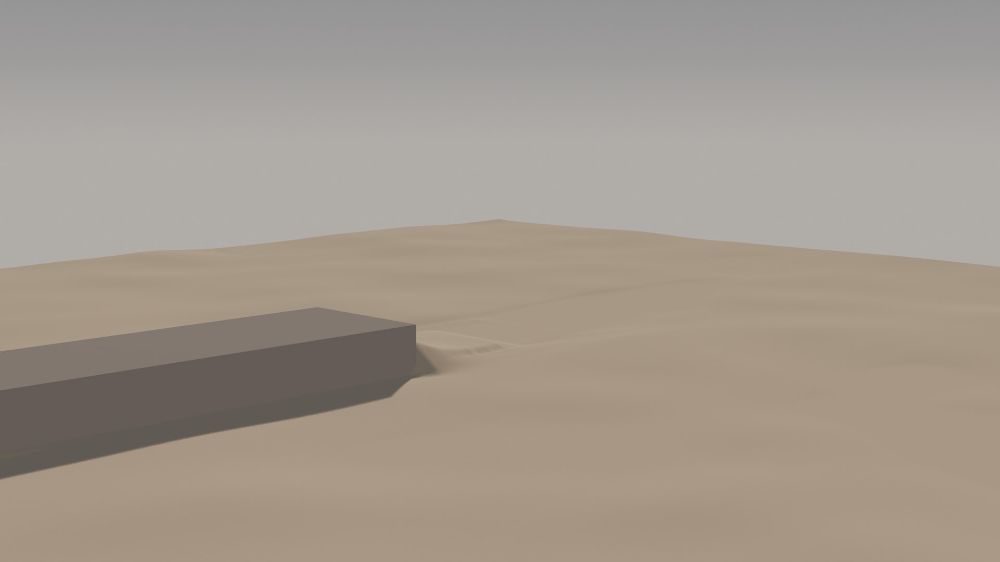

A rut imprinted across the field, fading faster where the wind is strongest and surviving in the lee

### Another Planet: Mars

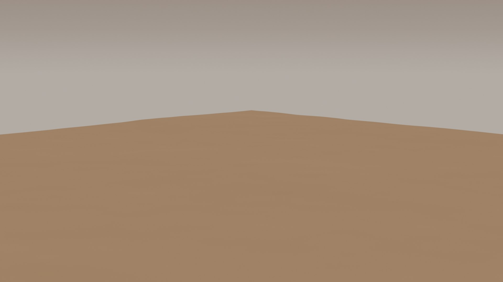

The same ORGANIC dune field as the other scenes with ONE switch different: Other Planet, set to Mars. Martian air is sixty times thinner than ours (0.020 against 1.20 kg/m3) and the saturation length divides by air density, so the same physics builds dunes far larger on the same ground. Turn Other Planet off and the scene rebuilds itself at Earth scale, which is the whole point of the comparison; scale the terrain object up if the Martian dunes outgrow the default 200 m domain

### Rock + Sand Source

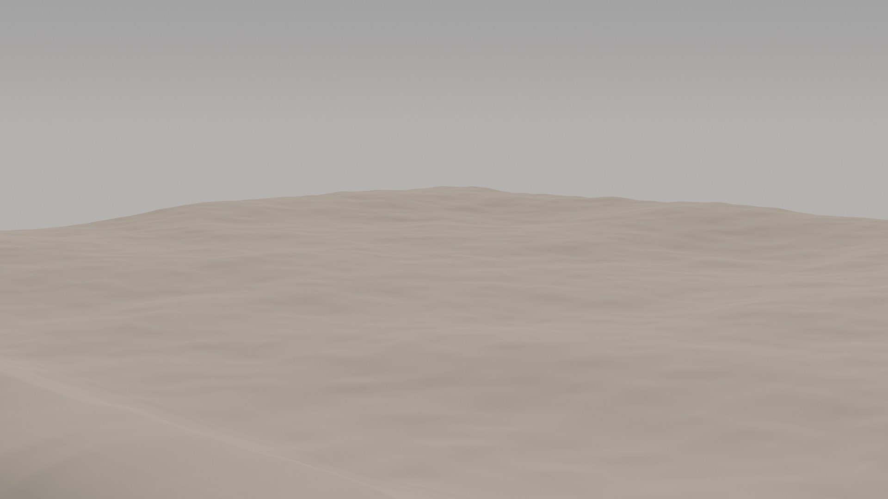

Start Terrain = Rock workflow: a rocky FBM terrain frozen as bedrock, with sand fed only from an upwind source zone so drifts grow from nothing over bare rock

---
