# DunesForge

**Wind-blown dunes, snow drifts, water and erosion for Blender.** Point it at a
terrain, give it a wind direction, press Play.

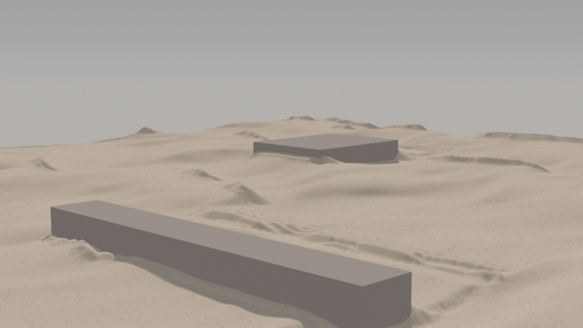

*Nothing here is keyframed or sculpted: every frame is the solver advancing.*

DunesForge grows real dunes instead of letting you sculpt approximations of
them. Sand climbs the windward slope, spills over the crest and slides down the
lee face when the pile gets too steep — so every dune in the shot carries the
same lee-face angle, because physics sets it rather than taste. The same solver
drives snow drifts, slab avalanches, flowing water, rain, frost, vegetation and
wind erosion, on the GPU, in the viewport.

This repository holds the **documentation, release notes and the issue
tracker**. The add-on itself is sold separately; there is no source code here.

**Current version: 0.85.0 beta** - the first public beta. See the
[release notes](CHANGELOG.md).

## Highlights

- **Real aeolian physics** — Jackson–Hunt shear with lee-side flow separation
  and avalanching at the angle of repose, the model the dune literature is
  built on
- **Things in your scene talk to the sand** — obstacles cast wind shadows,
  sources feed material, objects press their own shape into the surface. Move
  one while it plays and the drift follows
- **Not just white sand for snow** — snow sinters and hardens with age, forms
  weak layers and releases as slabs that scour their own path
- **Water that shapes the ground** — a shallow-water field that runs downhill,
  wets the sand it crosses, and undercuts its own banks
- **66 finished demo scenes**, each built to demonstrate a specific feature —
  open one, run it, take the settings
- **Three interface levels** — Simple, Standard and Advanced. Nothing is ever
  disabled, only hidden, so switching cannot change your simulation
- **GPU-resident with CuPy**, with a full NumPy CPU path when there is no CUDA
  card

| | |
|---|---|
| 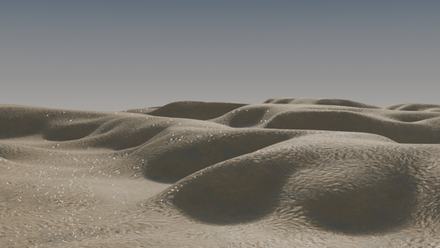 | 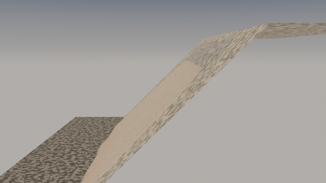 |
| 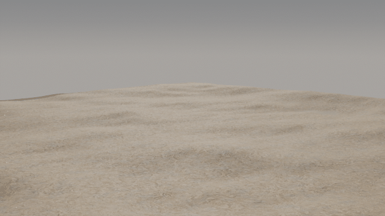 | 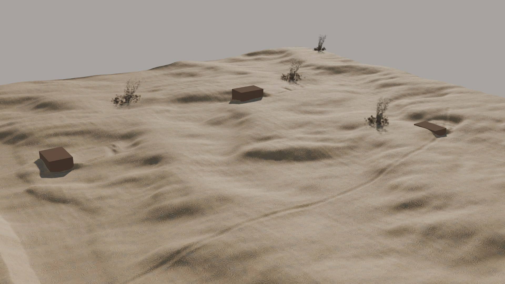 |
| 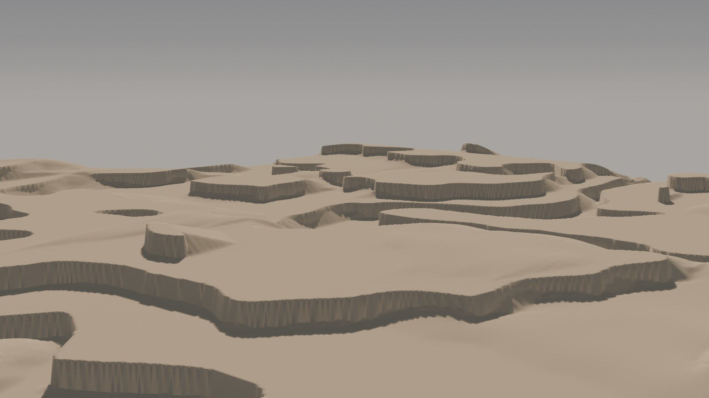 | 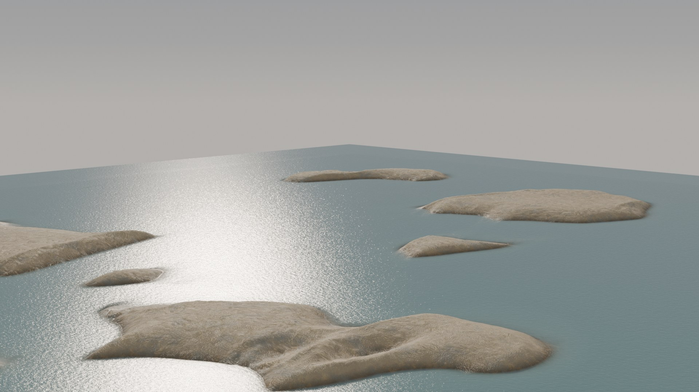 |
| 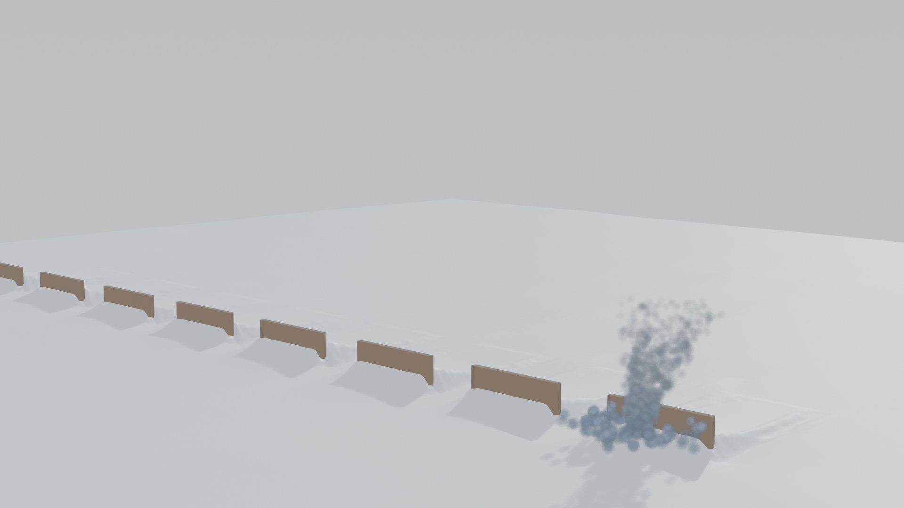 | 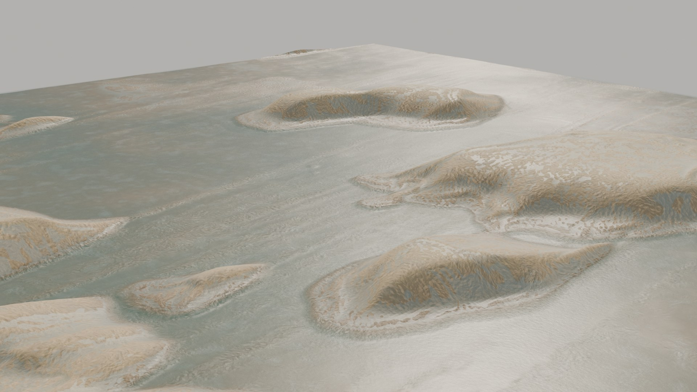 |
| 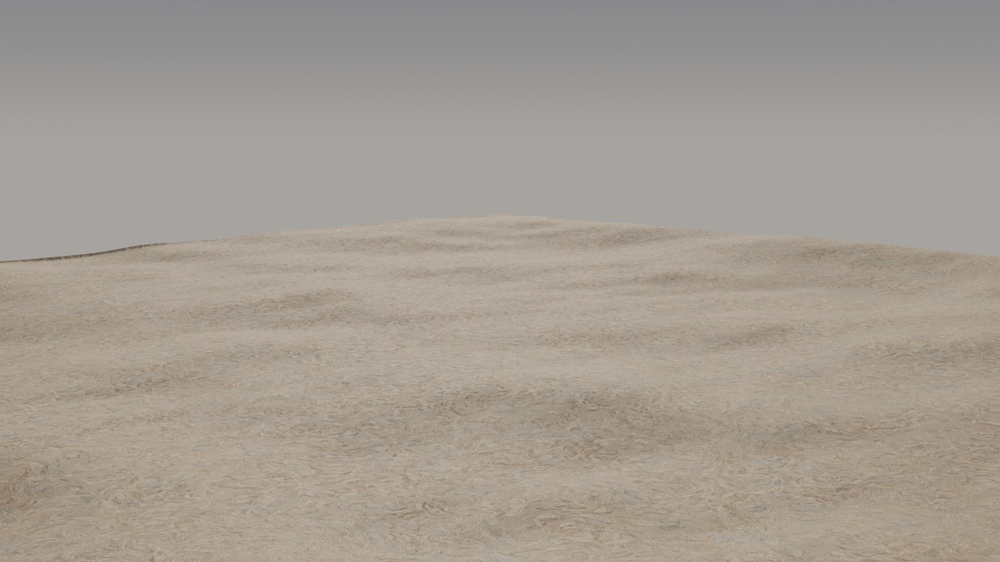 | 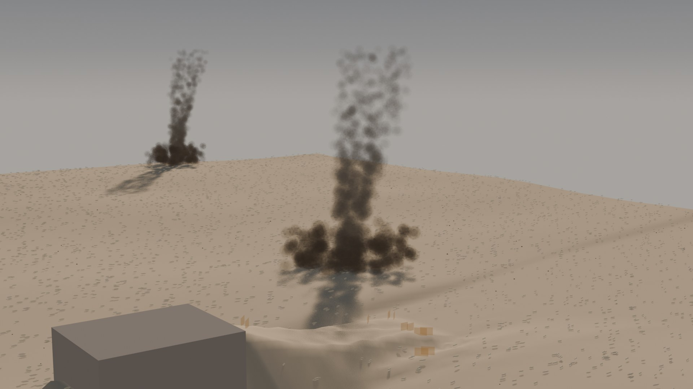 |

**[See the full gallery - 49 demo scenes](GALLERY.md)**, every one of them a
scene that ships with the add-on.

## Documentation

| Document | What it covers |
|---|---|
| [Getting Started](docs/DunesForge_GettingStarted.pdf) | ten minutes from installing to your first dune field — **start here** |
| [Troubleshooting](docs/DunesForge_Troubleshooting.pdf) | the most common problems and what to do about each |
| [QuickStart](docs/DunesForge_QuickStart.pdf) | a working guide from your first scene to a finished shot, with exercises |
| [Installation Guide](docs/DunesForge_Installation_Guide.pdf) | installing, GPU setup, what to do without a CUDA card |
| [Reference](docs/DunesForge_Reference.pdf) | every control in every panel, with defaults and when to reach for it |
| [Overview](docs/DunesForge_Overview.pdf) | what the product is and the problem it solves |
| [Scene gallery](GALLERY.md) | all 49 demo scenes with the descriptions from the add-on |

Release notes: [CHANGELOG.md](CHANGELOG.md)

## Requirements

Blender 4.2 or newer (tested through 5.3), Windows or Linux. An NVIDIA CUDA
card is recommended and makes it interactive; without one the same simulation
runs on the CPU, slower.

## Reporting a bug or asking for a feature

**[Open an issue](https://github.com/Forge-Plugins/DunesForge/issues/new/choose)**
and pick a form:

- **Bug report** — something does not work as the documentation describes.
- **Feature request** — an idea for a new control, demo scene or workflow.
- **Question** — how do I…?

For a bug, please give the version shown at the top of the DunesForge panel
and attach **tydunes.log** — the **Open Log Folder** button in the main panel
opens the folder that holds it.

Prefer e-mail? Write to **forgeplugins@gmail.com** — the same address takes bug
reports, feature requests and support questions. Please do not post licence or
purchase details in a public issue; send those by e-mail.

## Author

More plugins by the author: https://forgeplugins.tech

DunesForge and its documentation are © the author, all rights reserved.
Blender is a registered trademark of the Blender Foundation. DunesForge is not
affiliated with or endorsed by the Blender Foundation.
